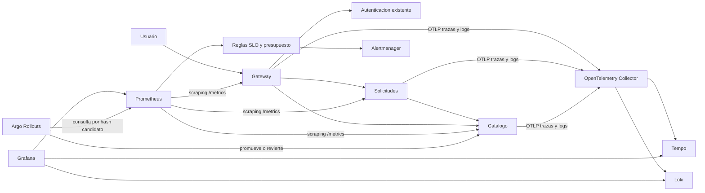

# Flujo de telemetría

Los tres servicios instrumentados son gateway, solicitudes y catálogo, dentro de
`sa-p9`. OpenTelemetry instrumenta las conexiones HTTP de Node y el cliente fetch;
el contexto W3C viaja en `traceparent`. En catálogo se instrumenta FastAPI. Los
spans permiten observar la llamada gateway → solicitudes → catálogo que ocurre
al crear una solicitud académica. La autenticación previa se conserva como
servicio independiente; no se afirma que esté instrumentada en esta práctica.

Las métricas HTTP usan contadores e histogramas por servicio, ruta normalizada,
método y estado. Prometheus añade `pod_template_hash` desde las etiquetas de cada
pod: el canary compara únicamente las series de su ReplicaSet candidato. Las
métricas de negocio cuentan solicitudes creadas, intentos rechazados y consultas
al catálogo. Los valores provienen de peticiones reales; el análisis no ejecuta
un Job ni devuelve respuestas prefabricadas.

Los eventos HTTP se imprimen en JSON y se envían por OTLP al Collector. Incluyen
servicio, ruta, estado, duración, `trace_id` y `span_id`. No se registran cuerpos,
contraseñas, tokens, cookies ni direcciones de correo. Loki almacena los eventos;
Tempo conserva las trazas. Grafana ofrece enlaces Loki → Tempo y Tempo → Loki. En el archivo de
aprovisionamiento se escapa el signo dólar de las variables de Grafana con
`$$` para conservar el identificador al cargar las fuentes de datos.
Los identificadores de traza no se convierten en etiquetas de métricas ni índices
de alta cardinalidad.

El stack tiene almacenamiento local persistente de 24 horas y servicios ClusterIP.
El acceso de demostración usa port-forward en la computadora del estudiante.
No se expone una API de telemetría pública. Prometheus, Grafana, Loki y Tempo usan
volúmenes separados de las bases de P9; los backups y su retención permanecen
bajo la configuración de P9.

El stack se define en GitOps: `p10-monitoring` instala la versión fijada del chart
kube-prometheus-stack; `p10-observability` instala Collector, Loki, Tempo, reglas,
PodMonitor, tablero y políticas. `p9-platform` mantiene la plataforma y recibe el
archivo de valores de P10. La raíz espera controladores, monitorización, servicios
y protección según sus ondas de sincronización.
